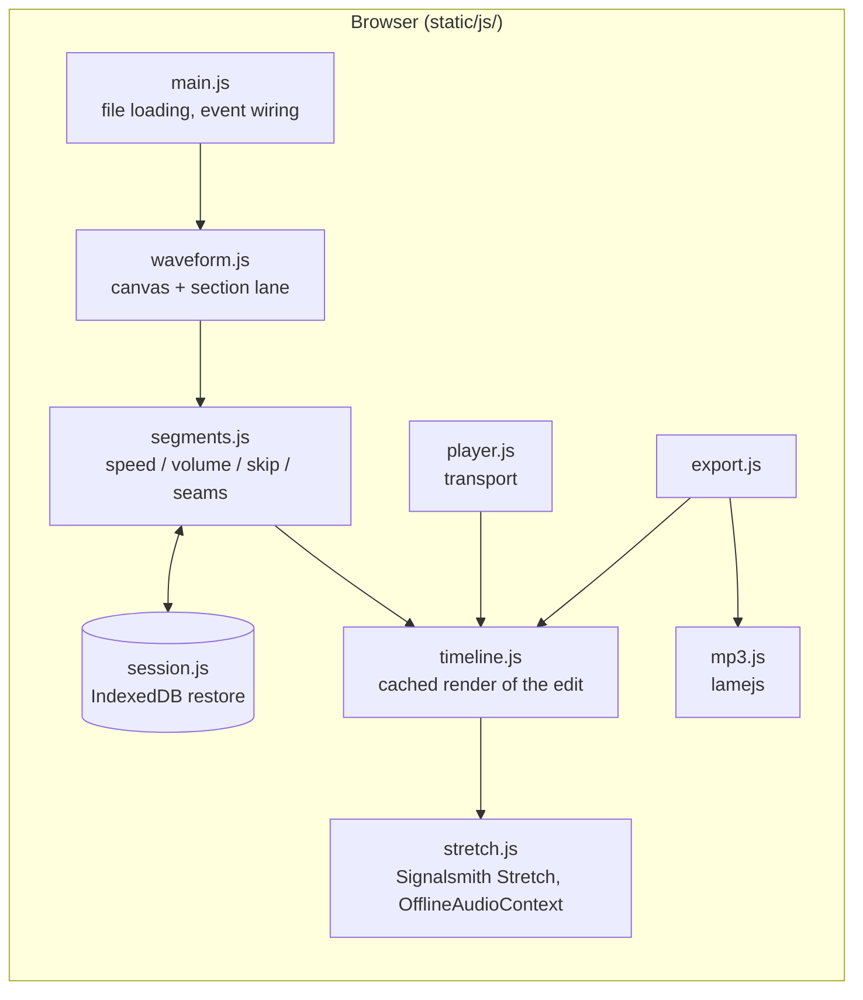

# Architecture

## 1. Overview

All audio processing runs in the browser. `static/` is published unchanged to
GitHub Pages by `.github/workflows/pages.yml` on every push to `main`; there is
no server (ADR 0012). A separate Python script does the same edit offline from
the command line (ADR 0011).

## 2. Playback and export

One render serves both (ADR 0009, 0010). `getTimeline()` renders the whole edit
through one stretcher node driven by a time map (ADR 0005), at the export
preset, and caches it until the next edit. The transport plays that buffer, and
export encodes the same buffer to MP3 at 192 kbps and saves it locally. Nothing
is uploaded.

Volume-only edits skip the render and play the original buffer with a live gain
schedule, ramped at each seam with the same `fadeCurve` the render uses.

The client path requires a secure context: `audioWorklet` is absent over plain
http on a non-localhost origin. GitHub Pages serves https; local
development on `127.0.0.1` is secure by the localhost exemption.

## 3. Offline script

`app/speed_changer.py` applies cuts, speeds and volumes to a file with librosa
and ffmpeg, configured in its `__main__` block. It is not part of the site
and has its own dependencies in `requirements-cli.txt`. It is a fallback and a reference implementation, not
kept in step with the browser engine (ADR 0011).

## 4. Known issues and trade-offs

1. **Video files only load where the browser decodes them.** Chrome and
   Android read the audio track of an mp4; iPhone Safari does not, and the
   user is asked for an audio file (ADR 0012).

2. **Memory scales with output duration.** Export holds the source, the render
   and the mp3 at once, so slowing down is what costs. A 3:11 source at 0.25x,
   the slowest the UI allows, peaked at 367 MB on an iPhone and completed.
   Older phones are unmeasured; iOS closes a tab that runs out of memory
   without a message.

3. **Pages caches for 10 minutes.** After a deploy a visitor can get old files
   for that long, possibly old and new modules mixed. Reloading after the
   window fixes it.

4. **Shared mutable frontend state**. The ES modules under `static/js/` pass
   state through one exported `state` object (`state.js`) rather than through
   arguments. It keeps the module graph acyclic and the split small, but any
   module can write any field, so the data flow is not enforced by the
   structure.
