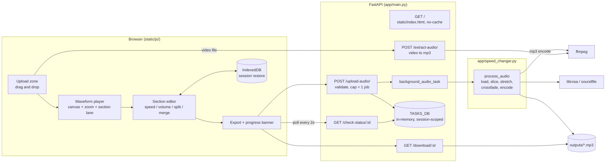
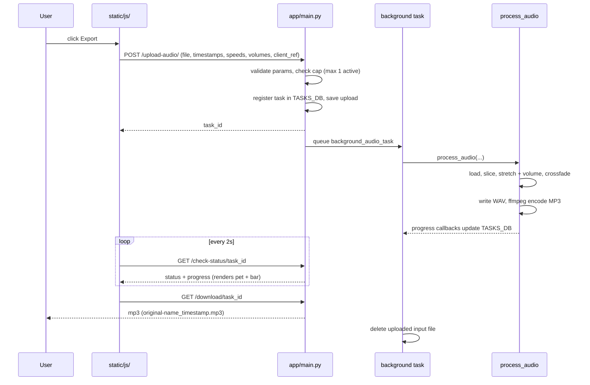

# Architecture

## 1. Overview

Three layers: a vanilla-JS frontend served same-origin, a FastAPI layer that
validates requests and tracks jobs in memory, and a pure processing core
around librosa and ffmpeg.

## 2. Export flow

## 3. Known issues and trade-offs

Findings from a code review on 2026-07-26. All are minor at the current
scale; listed so they are not rediscovered from scratch.

1. **Task-slot leak on unexpected upload failure** (`app/main.py`, upload step 2).
   If `save_upload` raises anything other than `HTTPException` (for example a
   disk error), the `except HTTPException` block does not fire, so the
   pending task record stays in `TASKS_DB` and occupies the single job slot
   for up to 24 hours, blocking all exports until cleanup. Catching
   `Exception` there would be safer.

2. **No concurrency cap on `/extract-audio/`** (`app/main.py`). Unlike
   `/upload-audio/`, video extraction is not limited, so several
   simultaneous ffmpeg processes could run on the 2-vCPU / 1 GB production
   box.

3. **In-memory task state** (`TASKS_DB` in `app/main.py`). A container restart
   forgets in-flight jobs; clients polling an old task get 404. Accepted
   trade-off for a single-worker deployment.

4. **Mixed logging styles**. `app/speed_changer.py` uses `print` while
   `app/main.py` uses `logging`, so container logs are inconsistent in format.

5. **Shared mutable frontend state**. The ES modules under `static/js/` pass
   state through one exported `state` object (`state.js`) rather than through
   arguments. It keeps the module graph acyclic and the split small, but any
   module can write any field, so the data flow is not enforced by the
   structure.
