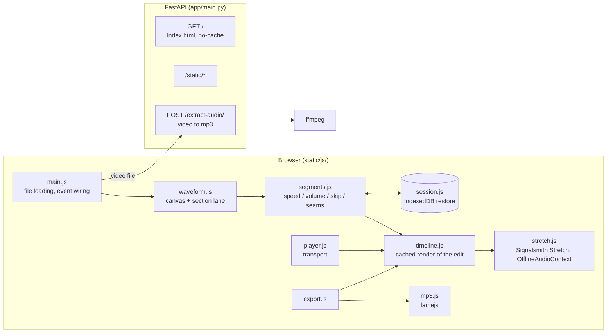

# Architecture

## 1. Overview

All audio processing runs in the browser. The FastAPI server serves the
frontend and does one job the browser cannot: extracting the audio track from
video containers Safari cannot decode. A separate Python script does the same
edit offline from the command line (ADR 0011).

## 2. Playback and export

One render serves both (ADR 0009, 0010). `getTimeline()` renders the whole edit
through one stretcher node driven by a time map (ADR 0005), at the export
preset, and caches it until the next edit. The transport plays that buffer, and
export encodes the same buffer to MP3 at 192 kbps and saves it locally. Nothing
is uploaded.

Volume-only edits skip the render and play the original buffer with a live gain
schedule, ramped at each seam with the same `fadeCurve` the render uses.

The client path requires a secure context: `audioWorklet` is absent over plain
http on a non-localhost origin. Production is behind nginx with TLS; local
development on `127.0.0.1` is secure by the localhost exemption.

## 3. Offline script

`app/speed_changer.py` applies cuts, speeds and volumes to a file with librosa
and ffmpeg, configured in its `__main__` block. It is not imported by the
server, is excluded from the Docker image, and has its own dependencies in
`requirements-cli.txt`. It is a fallback and a reference implementation, not
kept in step with the browser engine (ADR 0011).

## 4. Known issues and trade-offs

1. **No concurrency cap on `/extract-audio/`** (`app/main.py`). Several
   simultaneous ffmpeg processes could run on the 2-vCPU / 1 GB production
   box.

2. **Memory scales with output duration.** Export holds the source, the render
   and the mp3 at once. Slowing down is what costs: a 3:11 source at 0.38x
   peaked at 263 MB on a phone and completed, but a 5-minute file at 0.5x
   projects to about 450 MB, which may kill the tab on older iPhones with no
   error. See `design/handoff.md` section 6.2.

3. **Mixed logging styles**. `app/speed_changer.py` uses `print` while
   `app/main.py` uses `logging`. Only matters if the script is ever run inside
   the server again.

4. **Shared mutable frontend state**. The ES modules under `static/js/` pass
   state through one exported `state` object (`state.js`) rather than through
   arguments. It keeps the module graph acyclic and the split small, but any
   module can write any field, so the data flow is not enforced by the
   structure.
