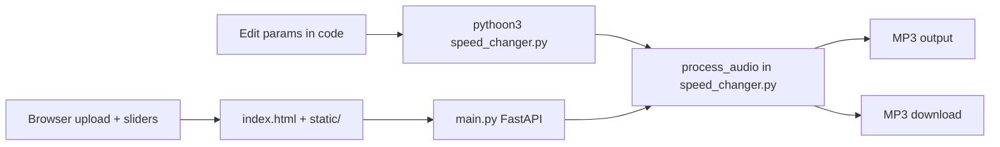

# TempoTailor — Music Speed Changer

Slice audio at arbitrary timestamps, adjust each segment's speed independently, and export as MP3. Two pathways share one core algorithm (`speed_changer.py`).



## CLI

```
conda activate librosa
python3 speed_changer.py
```

Edit `cut_timestamps`, `segment_speeds`, and `input_file` in the `__main__` block at the bottom of `speed_changer.py`.

## Web App

```
uvicorn main:app --reload --port 8000
```

Open `http://127.0.0.1:8000`, upload an audio file, add split markers, adjust per-segment speeds, and export.
